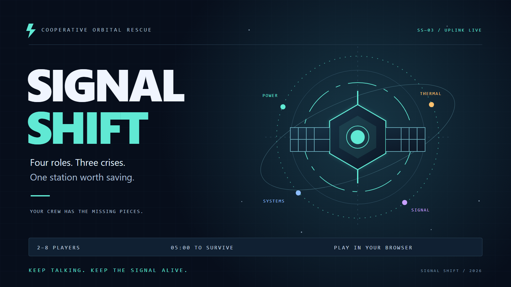
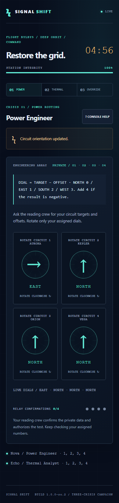
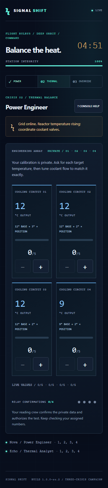
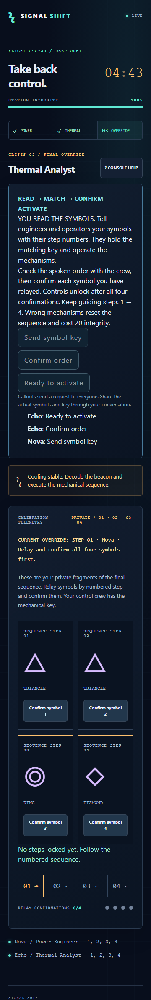
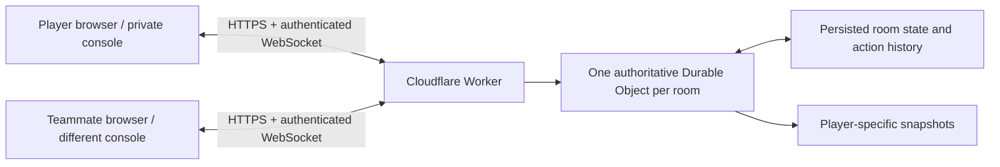

# SIGNAL SHIFT

**Keep the Signal Alive.** Four roles. Three crises. One signal.



**Creator: Quindel Logan**  
**Game Creator, Product Designer, Creative Director, and AI Development Lead**

[Play the released game](https://signal-shift.signal-shift.workers.dev/) · [Source on GitHub](https://github.com/eidoscoresys/signal-shift-multiplayer) · [Player guide](docs/PLAYER-GUIDE.md) · [Technical case study](docs/CASE-STUDY.md) · [Creator and AI credits](docs/CREDITS.md) · [Verification report](docs/TEST-REPORT.md)

SIGNAL SHIFT is a real-time cooperative browser game for **2–8 players**. A failing orbital station gives every player different information or controls. The crew must restore three connected systems within **one five-minute mission**, using conversation, numbered responsibilities and shared feedback.

## Creator and implementation credit

Quindel Logan originated the game concept and creative direction, defined the product requirements and milestones, approved development and release decisions, directed AI-assisted project management, and contributed live cooperative playtesting and actionable feedback.

**Built with OpenAI Codex.** Codex assisted with implementation, UI development, automated tests, debugging, deployment preparation and documentation under Quindel's direction. Quindel led the creative, product and release decisions throughout this AI-assisted process. Automated checks and human playtesting are documented separately. See [the contribution record](docs/CREDITS.md).

## Play

1. Open the [public game](https://signal-shift.signal-shift.workers.dev/), enter a callsign and create a flight.
2. Share its six-character room code or invite. Teammates use separate devices or browser profiles. A second tab in the same profile intentionally takes over the same player's console.
3. Wait for 2–8 connected crew, then the commander starts the mission.
4. Relay your private information by numbered sector. Use your assigned controls; every teammate has responsibilities.
5. Restore Power Routing, Thermal Balance and Final Override before the clock or integrity runs out. Review the shared results and replay with a new puzzle configuration.

Use a voice call or sit together. There is no built-in voice service or free-text chat. Final Override includes three fixed-phrase live requests, not automatic clue exchange. Refresh/reconnect restores identity, role and progress; it does not pause the mission.

## Roles and crises

| Role | Responsibility |
| --- | --- |
| Power Engineer | Operates assigned circuits, coolant valves and override mechanisms; holds private control calibration/key data. |
| Thermal Analyst | Reads assigned private targets and sequence fragments, relays information, confirms readings and authorizes system tests. |
| Signal Decoder | Translates assigned signal readings and relays private numbered sequence fragments; shares reading duties with analysts. |
| Systems Operator | Shares engineering controls through separately assigned numbered sectors and ordered mechanism steps. |

Two- and three-player crews combine specialties. Responsibilities lock when the mission starts. Across crews of 2–8, each control sector and reading fragment has an owner.

| Connected crisis | Cooperative task |
| --- | --- |
| Power Routing | Combine private direction targets and calibration offsets with the control crew's dials. |
| Thermal Balance | Match hidden target temperatures using private base/gain calibrations and coolant valves. |
| Final Override | Readers relay numbered symbols; controllers match their private symbol key; readers confirm; the assigned owners execute steps 1–4. |

Wrong tests/mechanisms cost 20 integrity and trigger a three-second interlock. A wrong override resets its sequence. The same five-minute deadline spans every crisis. [Rules and scoring](docs/RULES.md).

## Actual gameplay

These are unaltered browser captures of the released rc.2 game from automated multiplayer sessions with fictional callsigns. They are gameplay screenshots, not concept renders or evidence of physical-device testing. Each image links to its full-size capture.

| Power Routing | Thermal Balance | Final Override |
| --- | --- | --- |
| [](docs/screenshots/power-routing.png) | [](docs/screenshots/thermal-balance.png) | [](docs/screenshots/final-override.png) |

[Shared victory screen](docs/screenshots/victory.png).

## Architecture

**React · TypeScript · Vite · Tailwind CSS · WebSockets · Cloudflare Workers · Durable Objects · SQLite storage**



The Durable Object serializes room events and validates membership, role, sector ownership, phase and values. Shared state includes progress, integrity, score and the server deadline. Each browser receives only its authorized phase-specific clues. Seed values, explicit solutions, session digests and deduplication history are not sent to clients.

Random HttpOnly room-scoped cookies authenticate returning players. Secure cookies are required on public HTTPS. Action IDs prevent duplicate application; phase/mission context rejects delayed inputs. Persistence, heartbeat detection, reconnect backoff, host reassignment and single-console takeover support recovery. Separate room objects and session checks isolate crews. Fixed-vocabulary callouts use the same authenticated action/storage/broadcast path. [Protocol and recovery design](docs/PROTOCOL.md).

## Verified release and testing

The current release, **1.0.0-rc.3**, is deployed to Cloudflare Workers and verified on October 27, 2026. Its completed checks are **35 unit tests, 27 local browser tests and 23 public HTTPS/WSS acceptance tests**, with no failures/skips/flaky outcomes in their final complete runs. The public suite completed full missions for every crew size **2, 3, 4, 5, 6, 7 and 8** and exercised privacy, simultaneous inputs, recovery, replay, scoring, terminal states and the actual five-minute alarm.

The unit suite includes 700 action-solved campaigns across supported crew sizes and varied puzzle seeds. Automated accessibility scans found zero tagged WCAG A/AA violations on audited screens; this is not a full accessibility certification. Actual phones, Safari/Firefox, separate physical networks, a dedicated 24-hour cleanup soak and platform-forced hibernation remain unverified. [Methods, test-harness fixes and limitations](docs/TEST-REPORT.md) · [Historical release verification summary](docs/verification/released-rc2.json).

Creator credits are live on the accessible [About / Credits page](https://signal-shift.signal-shift.workers.dev/about), which opens without replacing the active console. Final credits/link and eight-player recovery rechecks passed alongside TypeScript, production build, deployment dry-run and published-asset checks. [Credits release report](docs/PORTFOLIO-TEST-REPORT.md). The earlier rc.2 verification record remains available separately.

## Local development

Requirements: Node.js 24 and pnpm 11.25.0. Install the tools from [Node.js](https://nodejs.org/) and [pnpm](https://pnpm.io/installation), then:

```sh
pnpm install --frozen-lockfile
pnpm exec playwright install chromium
pnpm build
pnpm server
```

Open http://127.0.0.1:8787. Local Wrangler emulates the Worker and Durable Objects without Cloudflare credentials. For frontend iteration, keep the Worker running and run `pnpm dev` in another terminal; open http://127.0.0.1:5173. Keep the hostname consistent because room cookies are host-specific.

```sh
pnpm check
pnpm test
pnpm test:browser
```

The full browser suite starts an isolated Worker at port 8788; the process-restart test also owns port 8790. Allow approximately 15–20 minutes, including the real five-minute deadline test. Tests do not reuse the player preview. Generated reports, traces, browser/session data, dependencies and build caches are ignored by Git. The portable PowerShell helper in scripts/pnpm.ps1 can use pnpm on PATH or a locally supplied PNPM_CLI_PATH.

To test a matching **deployed** version in PowerShell:

```powershell
$env:SIGNAL_BASE_URL='https://signal-shift.signal-shift.workers.dev'
pnpm exec playwright test
Remove-Item Env:SIGNAL_BASE_URL
```

Run this from the source revision that matches the deployed version; the public health/version assertion deliberately rejects a mismatched candidate.

## Deployment

The public application is hosted at **https://signal-shift.signal-shift.workers.dev/**. Wrangler binds static assets and one SQLite-backed GameRoom Durable Object per room. Preserve the existing `v1` migration and namespaces when deploying updates. Authenticate locally with Cloudflare's browser OAuth flow; never commit credentials. The public configuration contains no account identifier. If selecting among accounts, set CLOUDFLARE_ACCOUNT_ID locally. [Deployment runbook](docs/DEPLOYMENT.md).

## Development history

1. Foundation: reproducible dependencies, typed protocol, pure rules/generators and a real Worker runtime.
2. Two-player vertical slice: private complementary consoles, shared Power Routing and recovery.
3. Full campaign: four specialties, all crew sizes 2–8, three crises, synchronized clock/integrity/score/results/replay.
4. Production verification: accessibility, mobile controls, network recovery, security tests and published HTTPS/WSS acceptance.
5. Public release and live-playtest iteration: cover/submission materials and Final Override instructions, quick-callouts and persistent step feedback.
6. Portfolio preparation: explicit creator/AI attribution, non-interrupting credits, case study and audited GitHub publication workflow.

These are product milestones, not fabricated historical Git commits. The original checkout had no user commits or remote; private editor checkpoints are preserved locally. [Milestones](docs/MILESTONES.md) · [Case study](docs/CASE-STUDY.md).

## Source map

- `src/`: landing, lobby, private consoles, connection recovery, results and credits.
- `shared/`: wire types, build version and project links.
- `server/`: Worker endpoints, authoritative room, puzzle generation, rules and filtered snapshots.
- `tests/`: unit solvers and real-browser/runtime acceptance.
- `assets/` and `public/`: original cover artwork and web assets.
- `docs/`: guides, architecture/protocol, release evidence and portfolio case study.

## Licensing and publication status

**No open-source license has been selected.** Public visibility alone does not grant general permission to reuse this project. Dependencies retain their own licenses. Review [licensing options](docs/LICENSE-OPTIONS.md) before choosing terms for code and artwork.

The public repository https://github.com/eidoscoresys/signal-shift-multiplayer was created with Quindel's explicit approval. The audited source and [tagged verified release](https://github.com/eidoscoresys/signal-shift-multiplayer/releases/tag/v1.0.0-rc.3) use the creator-approved Git identity and the reviewed publication workflow. [Publication review](docs/PUBLICATION.md).
